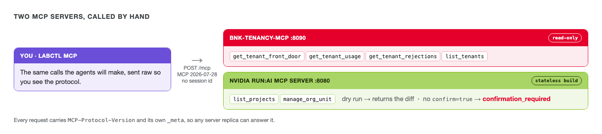

# The tools an agent gets



Agents don't log in to consoles. They call tools over the Model Context Protocol (MCP). This factory has
two MCP servers, and before you hand them to an agent, call them yourself.

| Server | Owner | What it can do |
|---|---|---|
| `bnk` | F5, built for this lab | Read each tenant's BNK front door, rate limit, 429s and tokens. Nothing else. |
| `runai` | NVIDIA, from Run:ai's source | Read and change Run:ai: projects, quotas, workloads. |

Both speak the newest MCP version, 2026-07-28, which has no sessions. Every request stands on its own, so
there's no login handshake first and nothing for a load balancer to keep sticky. `labctl mcp` uses that
version. They also speak the previous one, 2025-11-25, which is what NeMo Agent Toolkit's MCP client uses
today, so the agents in challenge 4 connect with that.

## The BNK side

```bash,run
labctl mcp bnk tools
```

You should see four tools, all marked `read-only`, and `session id: none` on the first line. An agent with
this server can see everything BNK knows about a tenant and change nothing.

Ask it about tenant-b:

```bash,run
labctl mcp bnk call get_tenant_rejections '{"project":"tenant-b"}'
```

You should see `"rateLimitRps": 10` and, while nothing is loading tenant-b, `"throttled": false`. This is
the tool the monitor agent will use to notice trouble.

## The Run:ai side

The Run:ai server has 27 tools. The one that matters here is `manage_org_unit`, which changes a project's
GPU quota. Ask it what raising tenant-b to 2 GPUs would do, with `dryRun`:

```bash,run
labctl mcp runai call manage_org_unit '{"action":"update","orgType":"project","name":"tenant-b","spec":{"quota":[{"nodePoolName":"default","gpuDeserved":2}]},"dryRun":true}' | jq '{dryRun, applied, before: .before.quota[0].gpuDeserved, after: .after.quota[0].gpuDeserved}'
```

You should see `"applied": false` and the quota going from `0.5` to `2`. Nothing changed: a dry run only
shows the diff.

Now the same call without `dryRun`:

```bash,run
labctl mcp runai call manage_org_unit '{"action":"update","orgType":"project","name":"tenant-b","spec":{"quota":[{"nodePoolName":"default","gpuDeserved":2}]}}' | jq '{isError, text}'
```

You should see `"isError": true` and `confirmation_required`. Run:ai's MCP server won't change a quota
until the call carries `confirm=true`. Check that nothing moved:

```bash,run
labctl tenant show tenant-b | grep -iE 'gpu deserved|rate limit'
```

Still 0.5 GPU and 10 req/s.

That `confirm=true` flag is the whole safety story for the rest of this lab. In the next challenges the
agents never get to send it. Only one tool can, and it asks you first.
