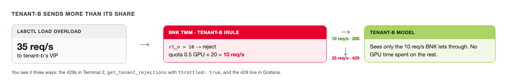

# tenant-b gets throttled



tenant-b's team just launched something popular. Their traffic jumps to 35 requests per second. Their
Run:ai quota is 0.5 GPU, so BNK lets 10 per second through.

Start that traffic in **Terminal 2** and **leave it running. Don't press Ctrl+C.** Challenges 4 and 5 need
these 429s. The load runs for 15 minutes. If it ends before you finish challenge 5, start it again.

```bash
labctl load overload --tenant tenant-b --rps 35 --seconds 900
```

You should see one line per second with about 10 `200`s and about 25 `429`s. The 429s come from BNK, at
the edge. Those requests never reach tenant-b's model server, so they don't take GPU time from anyone.

In **Grafana**, tenant-b's 429 rate climbs to around 25 per second within a minute. tenant-a and
dynamo carry on unchanged.

## What an agent would see

**Wait about a minute after starting the load.** The numbers below are averaged over the last minute, so
if you run this straight away you'll see `"throttled": false` and a low `"offeredRps"`.

Then, back in **Terminal**, ask the BNK MCP server the same question the monitor agent will ask:

```bash,run
labctl mcp bnk call get_tenant_rejections '{"project":"tenant-b"}'
```

You should see `"throttled": true`, `"rateLimitRps": 10`, `"offeredRps"` near 35, `"servedRps"` near 10
and `"rejectedRps"` near 25. If `"throttled"` is still `false`, wait a little longer and run it again.

Two ways to fix this. Someone could edit BNK's rate limit by hand, but then BNK and Run:ai disagree about
tenant-b's share, and the next quota change in Run:ai would overwrite the edit. Or tenant-b gets more
GPU quota in Run:ai, and BNK follows by itself. That second one is what the agents will propose.

Keep the load running in Terminal 2 and move on.
