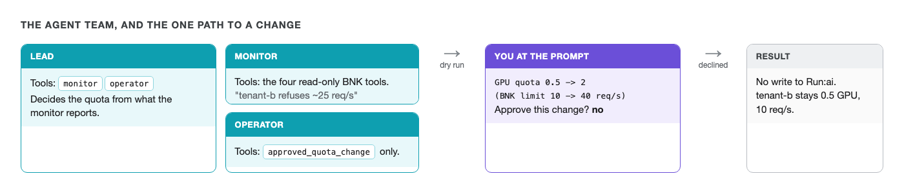

# The agent team



The team is three agents built with NVIDIA NeMo Agent Toolkit, running on NVIDIA Nemotron:

| Agent | Tools it holds | What it can do |
|---|---|---|
| **lead** | the other two agents | Ask the monitor, decide, hand the operator a proposal |
| **monitor** | the four BNK tools from challenge 2 | Read only |
| **operator** | `approved_quota_change` | Propose one Run:ai quota change, which you approve |

No agent holds `manage_org_unit` directly. `approved_quota_change` is the only thing that can call it, and
it runs Run:ai's dry run, shows you the diff and the BNK limit it implies, then sends `confirm=true` only if
you type exactly `yes`.

Have a look at the team's definition:

```bash,run
sed -n '/^functions:/,$p' /root/lab/agents/configs/factory-ops.yml
```

## Ask the team

tenant-b's load should still be running in **Terminal 2**. If it stopped, start it again and wait about a
minute before asking the agents, so the one-minute averages they read show the 429s:
`labctl load overload --tenant tenant-b --rps 35 --seconds 900`

In **Terminal**:

```bash
labctl agents
```

Watch the agents work. You should see the lead ask the monitor, the monitor call `list_tenants` and
`get_tenant_rejections`, then the lead work out the quota: 35 req/s needs at least 35, so 2 GPU (40 req/s)
in steps of 0.5. The operator calls `approved_quota_change`, and the run stops at a prompt like this:

```
Run:ai dry run for project tenant-b: GPU quota 0.5 -> 2 (BNK limit 10 -> 40 req/s). Approve this change? Type yes or no.
```

**Type `no`.**

You should see the operator report the decline, and the lead stop without asking again. The model can
word its reasoning differently from run to run. The prompt and its numbers come from Run:ai's own dry run,
so they don't change.

Check that nothing moved:

```bash,run
labctl tenant show tenant-b | grep -iE 'gpu deserved|rate limit'
```

Still 0.5 GPU and 10 req/s, and in **Grafana** tenant-b's 429s carry on.
