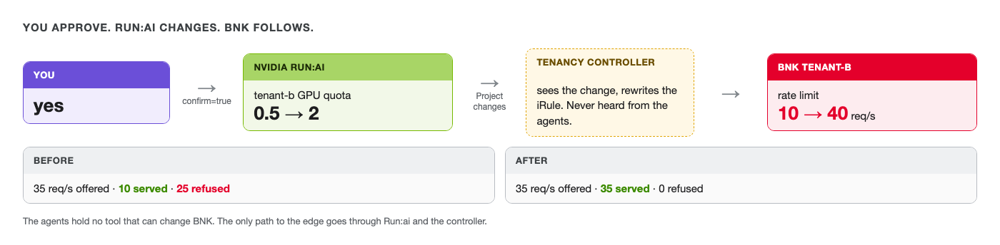

# Approve, and watch BNK follow



Same team, same question. This time you approve.

Make sure tenant-b's load is still running in **Terminal 2**. If it stopped, start it again and wait about
a minute before running the agents:
`labctl load overload --tenant tenant-b --rps 35 --seconds 900`

Open **Grafana** next to the terminal so you can see tenant-b's 429s when you approve.

> The agents use NVIDIA's hosted Nemotron, so give each run a minute. If it stops with a timeout or a
> `500` error, run the same command again.

```bash
labctl agents
```

At the prompt, **type `yes`.**

You should see `approved_quota_change` report `Applied: project tenant-b GPU quota 0.5 -> 2`. Within a few
seconds Terminal 2 shows the 429s dropping to zero, all 35 requests a second getting a `200`.

In **Grafana**, tenant-b's 429 line falls to zero within a minute, and its GPU quota steps from 0.5 to 2.

## What happened, step by step

Nobody touched BNK. Check each side.

Run:ai has the new quota:

```bash,run
kubectl get projects.kai.resources tenant-b -o jsonpath='{.spec.queues[*].resources.gpu.deserved}{"\n"}'
```

You should see `2`.

BNK's rate limit followed, because the controller saw the Run:ai change and rewrote tenant-b's iRule:

```bash,run
labctl tenant show tenant-b | grep -iE 'gpu deserved|rate limit|last event'
```

You should see `40 req/s`, and a last event from the controller about tenant-b's BNK config.

The agents read BNK, proposed a change in Run:ai, and you approved it. The controller kept BNK in line with
Run:ai, and BNK stopped refusing tenant-b. NVIDIA Run:ai and F5 BNK each did their own part, and the
agents never held a tool that could change BNK.

In the **Run:ai UI** tab (log in as `admin@acme.lab`, password `Lab-Admin-1!`), Projects shows tenant-b
with 2 GPUs.
