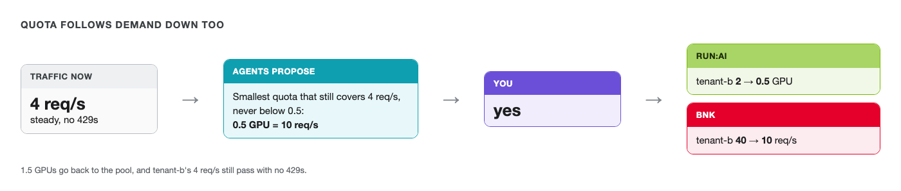

# Give the GPUs back



tenant-b's launch is over. Stop its load: in **Terminal 2**, press `Ctrl+C`. Then start the quiet
traffic it sends on a normal day:

```bash
labctl load steady --tenant tenant-b --rps 4 --seconds 900
```

You should see every request get a `200`. tenant-b now holds 2 GPUs of quota for 4 requests a second.
Those GPUs are reserved for tenant-b and no other tenant can count on them.

Wait a minute for the averages to settle, then ask the team about tenant-b:

```bash
labctl agents "tenant-b's traffic dropped. Is its GPU quota still right?"
```

You should see the monitor report tenant-b with no 429s and about 4 requests a second against a 40 req/s
limit, and the lead propose the smallest quota that still covers it. That's 0.5 GPU (10 req/s), since the
team never goes below 0.5. The prompt shows `GPU quota 2 -> 0.5 (BNK limit 40 -> 10 req/s)`.

**Type `yes`.**

```bash,run
labctl tenant show tenant-b | grep -iE 'gpu deserved|rate limit'
```

You should see 0.5 GPU and 10 req/s again. In **Grafana**, tenant-b's quota steps back down to 0.5 while
its requests carry on with no 429s.

The loop runs both ways. Quota follows real demand, and every change still goes past a person.
