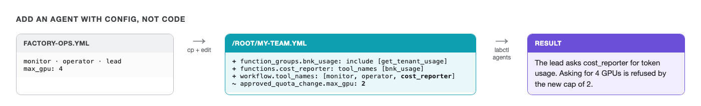

# Add an agent of your own



The whole team is one YAML file. Work on your own copy so the original stays as it is:

```bash,run
cp /root/lab/agents/configs/factory-ops.yml /root/my-team.yml
```

Open it in **Terminal 2** with `nano /root/my-team.yml` (save with `Ctrl+O`, `Enter`, exit with `Ctrl+X`).

## A cost reporter that can only read usage

Finance wants a quick answer to "how many tokens did a tenant use?", and nothing else. Give the team an
agent that holds exactly one tool: `get_tenant_usage` from the BNK MCP server.

Under `function_groups:`, add a second connection to the BNK server that exposes only that tool:

```yaml
  bnk_usage:
    _type: mcp_client
    server:
      transport: streamable-http
      url: ${BNK_MCP_URL}
      custom_headers:
        Authorization: Bearer ${BNK_MCP_TOKEN}
    include: [get_tenant_usage]
```

Under `functions:`, add the agent:

```yaml
  cost_reporter:
    _type: react_agent
    llm_name: nemotron
    tool_names: [bnk_usage]
    max_iterations: 6
    description: Reports how many tokens a tenant used, from BNK's meter. Read only.
```

Then let the lead use it. In `workflow:`, change `tool_names` to:

```yaml
  tool_names: [monitor, operator, cost_reporter]
```

Run your team:

```bash
AGENTS_CONFIG=/root/my-team.yml labctl agents "How many tokens has tenant-b used?"
```

You should see the lead hand the question to `cost_reporter`, which calls `get_tenant_usage` and answers
with tenant-b's token count. Compare it with BNK's ledger:

```bash,run
labctl tenant show tenant-b | grep tokens
```

`include:` is what limits the agent, not its description. The cost reporter's MCP connection only has
`get_tenant_usage`, so however it's asked, it has nothing else to call.

## Tighten the ceiling

In `functions:` → `approved_quota_change`, change `max_gpu: 4` to `max_gpu: 2`. Then:

```bash
AGENTS_CONFIG=/root/my-team.yml labctl agents "Raise tenant-b's GPU quota to 4."
```

You should see the operator get back `Refused: GPU quota must be above 0 and at most 2, got 4.` and no
approval prompt. If the lead proposes 2 instead, you'll get a prompt for `0.5 -> 2`: **type `no`**.

A policy change like this takes a one-line config edit, and the model has no say in it.
