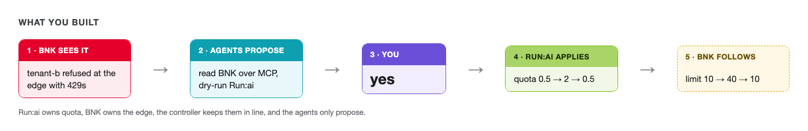

# What you built, and what's real



A tenant hit its limit. Agents noticed, worked out the fix and asked you. You said yes, and the fix
reached the edge without anyone configuring it. Then the traffic dropped and the GPUs went back to the pool
the same way.

Here's the state you left the factory in:

```bash,run
for t in tenant-a tenant-b dynamo; do
  printf '%-9s quota %-4s ' $t "$(kubectl get projects.kai.resources $t -o jsonpath='{.spec.queues[*].resources.gpu.deserved}')"
  labctl mcp bnk call get_tenant_rejections "{\"project\":\"$t\"}" 2>/dev/null | jq -r '"BNK limit \(.rateLimitRps) req/s, refused \(.rejectedRps) req/s"'
done
```

The **Grafana** tab here shows the last two hours rather than the last few minutes, so the whole session
is on one screen. Look at the **Project tenant-b** row. You should see tenant-b's 429s rise when its load
started, drop to zero when you approved 2 GPUs, and its GPU quota step 0.5 → 2 → 0.5. If your session ran
longer than two hours, the earliest part will be off the left edge.

## Who did what

| Part | Product | What it did here |
|---|---|---|
| GPU quota per tenant | NVIDIA Run:ai (open source) | Held each tenant's share, applied the change you approved |
| The agents | NVIDIA NeMo Agent Toolkit, NVIDIA Nemotron | Read BNK, reasoned about quota, proposed one change at a time |
| Agent tools | MCP on both servers: 2026-07-28 stateless, and 2025-11-25 for the agents | Run:ai's own MCP server and F5's BNK tenancy server |
| The edge | F5 BIG-IP Next for Kubernetes 2.4 | Front door per tenant, limits from quota, 429s before a GPU is touched, Dynamo worker picking |
| The glue | A small open-source controller | Watches Run:ai, writes BNK |
| The approval | You | Nothing changed without your `yes` |

## Real and simulated

Real: BNK 2.4, Run:ai's control plane and scheduler, Run:ai's MCP server (built from NVIDIA's source with
one change, so it runs without sessions), NeMo Agent Toolkit, Nemotron, NVIDIA Dynamo's operator and
routing, the controller and everything on the request path.

Simulated: the GPUs (NVIDIA's fake-gpu-operator), the model servers (vLLM simulators and Dynamo's Mocker,
which return filler text) and the BlueField DPU (a separate node with a tunnel standing in for the PCIe
link, so the request path is real but DPU offload isn't measured).

## Where this goes next

The approval is the right default while people learn to trust agents with capacity. A few directions
from here: per-agent token budgets enforced by BNK, NeMo Guardrails on the agents' own conversations, and
letting the agents raise quota by themselves within a budget, while anything outside it still needs a
person.
